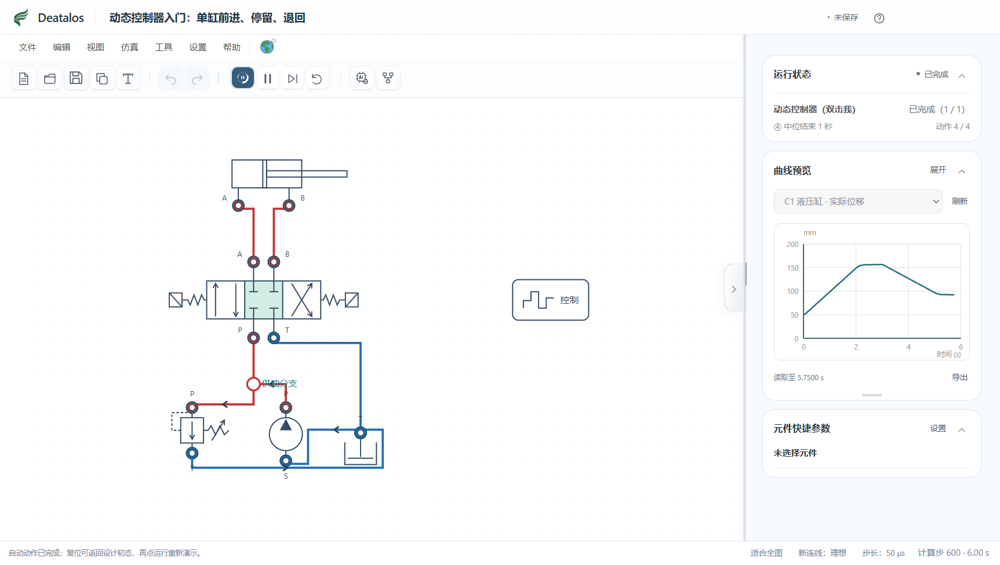

<p align="center">
  
</p>
<h1 align="center">Deatalos · 液压工作台</h1>
<p align="center">
  <strong>从一张液压原理图，到可分析的回路和可交付的工程文档。</strong><br>
  <strong>From hydraulic schematics to circuit analysis and engineering reports.</strong>
</p>
<p align="center">
  <a href="https://github.com/bjwjy/Deatalos/releases/download/v1.5.1/Deatalos-1.5.1-x64-Setup.exe"><strong>下载 V1.5 Windows x64 安装包 · Download Windows Installer</strong></a>
  · <a href="https://github.com/bjwjy/Deatalos/releases/tag/v1.5.1">发布说明 · Release notes</a>
  · <a href="#quickstart">跑一个示例 · Try an example</a>
  · <a href="#从源码运行">从源码运行</a>
  · <a href="#english">English</a>
</p>

**当前正式版 1.5.1**提供 Windows x64 离线安装包，约 112 MiB，内含运行环境。下载并运行 `Setup.exe` 即可安装。

本版增加可配置鼠标笔势、连续裁剪和自动低压续算，优化文件打开方式、AI 开关和星球换肤。[查看更新说明](docs/releases/1.5.1.md)。

**Deatalos 1.5.1** is available as an offline Windows x64 installer (about 112 MiB). Download and run `Setup.exe` to install. This update adds configurable mouse gestures, continuous pipe trimming, automatic low-pressure continuation, and faster theme switching.

Deatalos 把原理图绘制、油路诊断、瞬态仿真、工况计算和工程出图放在同一个 Windows 工作台。它面向液压教学、回路设计和工程初算，适合从泵、阀、缸和马达搭起回路，再用曲线和计算结果检查设计。



<a id="quickstart"></a>

## 跑一个示例 · Try a circuit

**单缸自动往返 · Automatic single-cylinder cycle**。定量泵从油箱供油，溢流阀限压，V1 换向阀切换液压缸的伸出和回程。控制器的四步动作已经配好，打开工程就可以运行。

1. 安装并打开 Deatalos。打开[示例工程文件](examples/single-cylinder-cycle.hydx)，点文件页右上角的 **Download raw file**（下载原始文件），保存为 `single-cylinder-cycle.hydx`。
2. 在软件里点 **文件 → 打开工程…**，选刚下载的文件。如果当前是未保存的空白工作区，出现提示时点确认继续。
3. 点工具栏的 **▶ 运行**。油缸依次**伸出 2 秒 → 停留 1 秒 → 缩回 2 秒 → 中位结束 1 秒**。仿真时间到 6 秒后，右侧运行状态显示「已完成」。
4. 在右侧 **曲线预览** 选择 **C1 液压缸 · 实际位移**，点 **刷新**。曲线先上升、再趋平、随后下降。要再跑一轮，先点 **复位**，再点 **运行**。

**English.** On the [example file page](examples/single-cylinder-cycle.hydx), choose **Download raw file**. In Deatalos, select **File → Open Project** (`文件 → 打开工程…`), open the `.hydx` file, and press **Run** (`运行`). The cylinder extends, holds, retracts, and stops at 6 s of simulation time. In the right-hand **Curve Preview** (`曲线预览`), choose **C1 cylinder · Actual displacement** (`C1 液压缸 · 实际位移`) and click **Refresh** (`刷新`).

## 核心能力 · Highlights

- **画图和布线 · Draw and route.** 从元件库搭回路，自动整理元件和线条，调整绘图路径及物理管路参数。 Build circuits from the component library, arrange symbols, route lines, and edit physical pipe parameters.
- **仿真和读曲线 · Simulate and inspect.** 用 HopsanCore 对受支持回路运行、暂停和单步，读取压力、流量和位移的实际采样点，比较历史记录。 Run or step supported circuits with HopsanCore, inspect recorded pressure, flow, and displacement samples, and compare runs.
- **多工况计算 · Size across operating cases.** 核算压力、流量和功率，比较多执行器工况下的候选方案，输出计算书或选型任务书。 Estimate pressure, flow, and power, compare options across actuator operating cases, and generate calculation reports or sizing briefs.
- **工程出图 · Export drawings and results.** 设置纸张方向、标题栏、装订边和模板，导出 PDF、PNG、JPG、可选 SVG，以及曲线、CSV 和 Word 文档。 Configure drawing sheets and title blocks, then export diagrams, curves, CSV data, or Word reports.

## 能做什么

| 功能 | 可以完成的工作 |
| --- | --- |
| 原理图绘制 | 从元件库添加泵、油箱、阀、缸、马达、仪表及控制器等元件。连接油口、添加分支节点和文字标注，支持框选、复制、旋转及撤销重做。 |
| 整理与管路编辑 | 自动整理元件与走线，也可手动调整绘图路径。按需要编辑物理管路参数，将图面走线和用于计算的管路条件区分开。 |
| 参数与诊断 | 编辑元件参数和设计初态。查看油口、压力、流向和运行状态。检查失败时，在诊断面板查看关联对象、异常字段及处理提示。 |
| 教学与瞬态仿真 | 教学界面包含油缸、马达和参考回路样例。进阶版支持运行、暂停、单步、复位及步长设置，可观察受支持元件在换向或控制动作中的变化。 |
| 测量与曲线 | 查看执行器位移、压力、流量等可用量，放大或平移曲线，读取并固定真实采样点，比较历史记录。曲线可保存为数据文件，重新导入后查看。 |
| 基础与多工况计算 | 从设计参数估算流量、压力和功率。对多个执行器可按工况选择参与对象并比较候选方案，输出计算依据和选型任务书。 |
| 出图与文档 | 原理图可查看整张图纸或放大到回路，编辑标题栏、纸张方向及装订边。默认可导出 PDF、PNG、JPG，SVG 可在设置中启用。另可导出曲线图、CSV 和 Word 计算书。 |
| 工程与工作区 | 支持打开、保存、另存和恢复副本。常用显示项、元件库模式、四套配色及导出默认值可在工作区调整。 |
| 本机 AI 接入 | 使用 hydraulic MCP 提交最多 120 条编辑命令，预览可定位漏接端口。用户在工作台确认候选。工具栏开关控制本次 AI 接入和仿真权限，设置可调整启动默认值。 |

## 从源码运行

需要 Windows x64、Git、Node.js 24 和 npm 11。Windows 构建使用系统 .NET Framework 4.x 的 C# 编译器生成本机工具客户端。首次安装依赖需要访问 npm 和 Electron 下载源。

```powershell
git clone https://github.com/bjwjy/Deatalos.git
cd Deatalos
npm ci
npm run build
npm run start:teaching
```

要打开进阶界面，可改用 `npm run start:advanced`。运行进阶瞬态仿真前，请按[原生仿真环境说明](docs/NATIVE.md)准备 Hopsan 2.24.4、构建项目扩展，并将原生资源放入构建目录。原生模型与 ABI 见 [MODELS.txt](apps/desktop/native/MODELS.txt)。

```powershell
npm test
npm run check:architecture
npm run check:integration
```

运行 `npm test` 可构建公开源码并执行回归测试，包括图框单元格操作。进阶原生依赖从零搭建及在其他机器上的运行仍需复验。计算与仿真适用于项目已实现的元件模型和回路条件，工程选型还需核对厂家数据与实际工况。

## 基于什么开发

- **项目起点**源自自研的 HydraulicWorkbench 教学工作台。V1.4 延续其中的教学引擎，同时加入独立的进阶工作台、工程文件处理和辅助计算。源码树中的 `HydraulicWorkbench_v1.0/` 保存当前构建使用的教学引擎、样例及测试。
- **桌面和界面**采用 Electron、TypeScript、HTML/CSS 与 SVG。原理图符号由项目代码绘制，工程文件、计算和原生访问分层实现。
- **进阶仿真内核**调用 Hopsan 2.24.4 的 HopsanCore 及上游默认元件库。HopsanCore 负责网络耦合和时间推进。本项目以 C++ 实现宿主桥接及一组教学元件模型。参见 [Hopsan 上游](https://github.com/Hopsan/hopsan)和[原生模型说明](apps/desktop/native/MODELS.txt)。
- **工程与交互参考**包括 FluidSIM 的公开元件说明及液压教学中常见的绘图和操作方式。FluidSIM 用于了解元件工作原理和交互。本项目的界面、符号及扩展模型由项目实现。参见 [FluidSIM 公开分流集流阀说明](https://www.art-systems.de/www/site/en/fluidsim/comp-lib/html/p2_1_1_8_10.html)。
- **第三方计算与导出**包括 fluids 的 Clamond 管摩擦计算移植，以及 PDF 处理库 pdf-lib。来源与许可见[第三方声明](THIRD_PARTY_NOTICES.md)。

## 源码在哪里

| 目录 | 内容 |
| --- | --- |
| `apps/workbench/` | 原理图、元件库、仿真操作、计算与导出界面 |
| `apps/desktop/` | Electron 宿主、文件与导出服务、原生内核桥接和本机客户端 |
| `packages/` | 领域定义、计算、工程文件与应用逻辑 |
| `tests/` | 公开回归测试、生成式夹具和参考算例 |
| `tools/` | 构建、架构检查和原生环境准备 |

## 反馈与贡献

欢迎通过 [GitHub Issues](https://github.com/bjwjy/Deatalos/issues) 提交问题、功能建议或算例。报告问题时，可以附上使用版本、Windows 版本、复现步骤、预期与实际结果，以及可公开的最小示例。若问题涉及仿真，附上回路拓扑、边界条件、步长和诊断信息会更容易复现。

修改代码时，建议附上相应的测试或算例及检查结果。项目自有源码采用 [Apache License 2.0](LICENSE)。第三方依赖、移植代码及其声明沿各自许可，见[第三方声明](THIRD_PARTY_NOTICES.md)。

## English

**Deatalos is a Windows desktop workbench for hydraulic circuit design, simulation, and preliminary engineering calculations.** It is designed for students, instructors, and engineers who want to work through a circuit from schematic to report. The V1.4 desktop interface is primarily in Chinese.

Build a circuit with pumps, valves, cylinders, motors, and instruments. Inspect connections, initial conditions, and diagnostics. For supported circuits, run, pause, or step a transient simulation, then inspect and compare the recorded curves. Use sizing tools to estimate operating requirements and export the schematic, curve data, or a calculation report.

### Build from source

Install Git, Node.js 24, and npm 11 on Windows x64. The Windows build also uses the .NET Framework 4.x C# compiler for the local tool client.

```powershell
git clone https://github.com/bjwjy/Deatalos.git
cd Deatalos
npm ci
npm run build
npm run start:teaching
```

Use `npm run start:advanced` to open the advanced workbench. Its transient solver requires a local Hopsan environment and the Deatalos native extension. See the [native setup guide](docs/NATIVE.md). Run `npm test` for the public tests. The public test suite includes title-block table editing. Rebuilding the native environment from scratch has yet to be independently verified.

### Technology and credits

The desktop application is built with Electron, TypeScript, and SVG. HopsanCore 2.24.4 provides network coupling and time integration. Deatalos supplies the desktop workflow, native bridge, and its own teaching component models. Public FluidSIM component documentation informed parts of the engineering reference. For the model scope and the licenses of Hopsan, fluids, pdf-lib, and other dependencies, see [Third-party notices](THIRD_PARTY_NOTICES.md).

Report a bug or suggest a feature in [GitHub Issues](https://github.com/bjwjy/Deatalos/issues). For simulation issues, include the circuit, boundary conditions, time step, and diagnostics when possible. Project source is available under the [Apache License 2.0](LICENSE).
